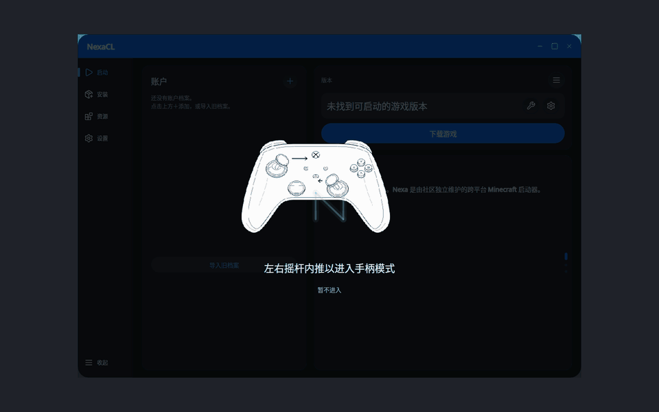

# Controller entry presentation

This unit implements controller discovery and the entry presentation only. The
future Steam-style large-screen workspace has no navigation or product content
yet. Presence alone never enables controller mode.

Desktop owns the native input lifetime and the gesture state machine. The renderer
receives an NXML modal overlay and immutable image recipes, with no native input
polling or service access. Known Sony, Xbox and Wii U Pro layouts select the three
user-supplied drawings; unidentified pads use the offset layout without claiming a
brand. Original SVGs remain editable assets. Their bounded SMIL path/opacity motion
is baked into reusable small sprite sheets, not reparsed on each presentation
frame. Each sheet fits the renderer's existing critical-memory admission budget.

After a pad is discovered, darken the complete client area and loop its inward-stick
demonstration with “左右摇杆内推以进入手柄模式”. Both axes must first be neutral,
then the same device must hold left X >= .65 and right X <= -.65 for 200 ms, with
vertical axes within .45. Different devices cannot combine halves of the gesture.
Drift, already-held input at attachment and background input cannot activate it.

Confirmation fades the prompt away, smoothly enlarges the existing window to the
current monitor's full bounds over 600 ms, and switches to an opaque dark entry
canvas. The NexaCL N icon fades/scales in, then fades away, leaving an empty dark
canvas after 1.8 seconds. No large-screen navigation is introduced here. Escape
or the pad's back/cancel button restores the original window state and focus.
Disconnect removes the prompt or exits the entry canvas. Dismissed devices do not
immediately prompt again until reattached. Reduced motion settles transitions and
uses a static demonstration. Native readers and timers are disposed with Desktop.

Native readers use Windows XInput plus nonexclusive Raw Input HID, Linux's
nonblocking joystick interface, and macOS GameController extended gamepads. Sony
HID Z/Rz axes are distinguished from Rx/Ry analog triggers. HID logical ranges
are normalized before applying the gesture thresholds. Devices inaccessible to
the OS reader cannot activate entry; no guessed input or elevated access is used.

## Verification and preview

The Desktop suite passes 365 tests, including neutral/held/unready input, mixed
devices, background input, cancellation/suppression, reconnection, disposal,
layout selection, shared artwork and reduced motion. Native offscreen capture
under X11 with a window manager checks all three layouts in both color schemes,
decoded hand/icon pixels, actual fullscreen bounds/state, restoration from normal
and maximized windows, and subsequent unmaximize bounds. Input is simulated for
these deterministic captures; physical Windows/macOS controllers remain untested.

The native window must submit its normal-size layout before re-maximizing on exit,
so the window manager does not retain the fullscreen animation's final size as the
next normal restore size. Native title controls follow the client scrim, including
the macOS standard window buttons.

Static captures for each layout/theme and the entry icon are stored beside the GIF.

Release compilation, 72-project architecture checks, format verification and
Linux NativeAOT publication plus `--validate-shell` pass. NativeAOT retains the
existing third-party `Jint` `IL2098` warning. Already-fullscreen windows keep their
native fullscreen state while playing the entry icon animation.
